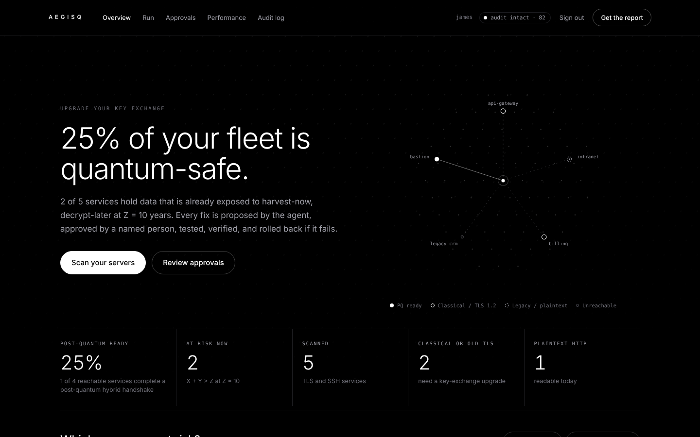
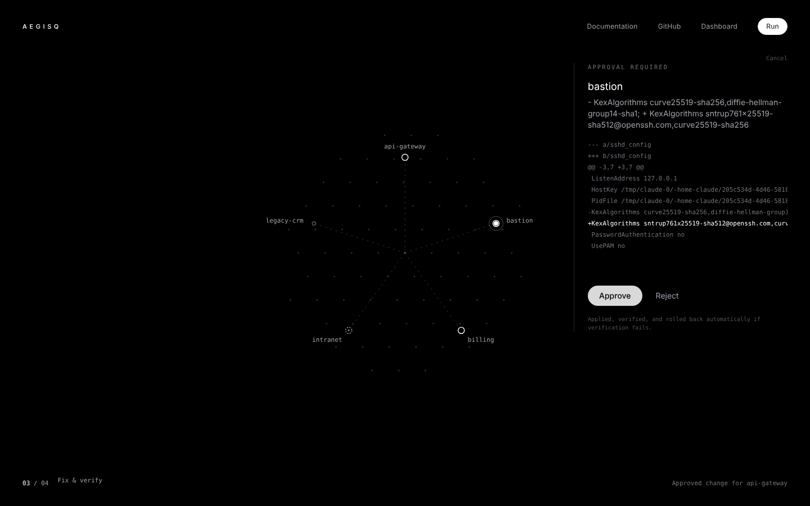

<p align="center"></p>

<h1 align="center">AegisQ</h1>

<p align="center">Runs on Windows, macOS and Linux · Python 3.10–3.13 · web app + CLI · agentic AI (Gemma 4, Claude or rules) · CycloneDX 1.6 CBOM · ML-KEM hybrid TLS and SSH</p>

**A post-quantum migration engine: it finds the servers that are still classical, shows which ones matter most, and fixes them safely with a human in the loop.**

Traffic recorded today can be decrypted once a large quantum computer exists ("harvest now, decrypt later"). Chrome, Firefox, Cloudflare and OpenSSH 10 already use hybrid post-quantum key exchange, but most company web servers, internal services and SSH endpoints do not. AegisQ:

1. **Scans:** probes every TLS and SSH service with real post-quantum handshakes.
2. **Inventories:** writes a Cryptographic Bill of Materials (CBOM) in CycloneDX 1.6, validated against the official schema.
3. **Scores:** ranks services with Mosca's inequality (X + Y > Z), with Z as a dashboard slider.
4. **Fixes:** an agentic AI (Gemma 4 by default, or Claude) plans the migration, proposes a minimal config patch (the key-exchange line of nginx, Apache, HAProxy, Caddy, Postfix, Dovecot or OpenSSH), waits for a named human to approve it, applies it, verifies it, and rolls back on failure. Every safety rule is enforced in Python, not in the prompt; a deterministic rules planner does the same without AI.
5. **Reports:** builds the migration report from a tamper-evident, hash-chained audit log.

It also measures what the switch costs with a handshake benchmark. Everything can be run from the **web app** (a guided **Run** console with a live fleet view and inline approvals) or from the `aegisq` command line.

---

## Quick start

You need **Python 3.10+** and, for the demo servers only, **Docker Desktop**.

**1. Install** (once, in the repo folder):

| Windows (PowerShell) | macOS / Linux |
|---|---|
| `py -m venv .venv` | `python3 -m venv .venv` |
| `.venv\Scripts\activate` | `source .venv/bin/activate` |
| `pip install -e ".[dev,agent]"` | `pip install -e ".[dev,agent]"` |

`pip install -e .` installs AegisQ from this folder and adds the `aegisq` command to the virtual environment. The extras add the test tools (`dev`) and the Claude planner (`agent`); the Gemma 4 planner needs no extra. Run `aegisq doctor` to see which optional parts are available.

**2. Add your keys (optional).** Create `demo/.env` with one `NAME=value` per line. Every key is optional; see [Keys](#keys-yours-someone-elses-or-none) for what each one adds and what works without it.

```
GEMINI_API_KEY=...               # agentic AI with Gemma 4 (free: aistudio.google.com/apikey)
AEGISQ_API_TOKENS=you:<16+ random characters>   # your dashboard login
AEGISQ_AUDIT_KEY=<long random string>           # HMAC audit chain
```

Make random strings with `python -c "import secrets; print(secrets.token_urlsafe(24))"`. Then run `aegisq doctor`: the first line shows the `.env` file it loaded, and every optional part says `ok` or how to enable it (`--` means optional and off, not broken).

**3. Start the demo servers** (7 containers on 127.0.0.1; Docker Desktop must be running):

```
docker compose -f demo/docker-compose.yml up -d --build app-modern app-legacy app-tls12 app-ready app-plain ssh-pq ssh-legacy
```

**4. Open the web app and run everything from there:**

```
aegisq serve --inventory demo/fleet.yaml
```

Open http://127.0.0.1:8000, click **Run** and sign in with your token (the part after the colon in `AEGISQ_API_TOKENS`, or the one-time token `serve` prints). Run is one guided flow:

1. **Targets:** the inventory, or any servers you type, one per line (`cloudflare.com`, `github.com:22 ssh`, `mail.example.com:993 tls payments`).
2. **Agent:** *Scan only*, or *Scan + fix* with the Rules, Gemma 4 or Claude planner (options without a key are greyed out with the reason).
3. **Start run:** every service appears as a node on the lattice and lights up as its real handshake completes. When the agent proposes a change, its diff appears beside the lattice with **Approve** / **Reject**.
4. **Results:** one page per run, step by step: scan, handshake analysis with the Mosca margin, fix & verify (outcome, before → after, who approved), and the audit events the run added, each with its raw command output.

Each step runs the real `aegisq` command in the background; a cancelled migration rolls back anything unverified and withdraws its approval request. Start with `--read-only` to show results without the Run buttons.

**Or use the terminal** (the same commands on every OS):

```
aegisq scan demo/fleet.yaml               # real PQ handshakes against every service
aegisq cbom --out cbom.json               # CycloneDX 1.6 CBOM, schema-validated
aegisq risk --sweep 5,10,15,20            # Mosca ranking across Z assumptions
aegisq serve --inventory demo/fleet.yaml  # dashboard on http://127.0.0.1:8000
aegisq migrate demo/fleet.yaml --planner local   # Gemma 4 agent: approve each change on the dashboard
aegisq migrate demo/fleet.yaml --planner rules   # same, no AI
aegisq migrate demo/fleet.yaml --approve-in terminal   # approve each diff in this terminal instead
aegisq benchmark https://localhost:8443/ # handshake cost: hybrid ML-KEM vs X25519
aegisq audit verify                       # check the hash-chained audit log
aegisq report                             # migration report (Markdown + HTML)
```

**Docker only (no Python on the host):** `docker compose -f demo/docker-compose.yml up -d --build` starts the demo servers plus the dashboard on http://localhost:8000, with the same Run section (token `aegisq-demo-token-change-me` unless `AEGISQ_API_TOKENS` is in `demo/.env`). Run commands with `docker compose -f demo/docker-compose.yml run --rm --no-deps aegisq scan fleet.docker.yaml`. If you later run the native dashboard, stop this one first (`docker stop aegisq-dashboard`) or use `--port 8001`. See [TESTING.md](TESTING.md#docker-only-windows-or-no-python-setup).





### The demo fleet

| Service | What it is | Expected result |
|---|---|---|
| `app-modern` :8443 | nginx 1.29 on OpenSSL 3.5, classical config | patched, verified **PQ ready** |
| `app-legacy` :8444 | nginx 1.25 on OpenSSL 3.0 | **planned failure**: `nginx -t` rejects the group, config restored, agent names OpenSSL 3.0 as the root cause |
| `app-tls12` :8445 | modern library, TLS 1.3 disabled | patched (protocols + groups), verified |
| `app-ready` :8446 | already `X25519MLKEM768` | left alone |
| `app-plain` :8080 | plaintext HTTP | flagged critical whatever Z is |
| `ssh-pq` :2222 | OpenSSH 10.2 | `mlkem768x25519-sha256` |
| `ssh-legacy` :2223 | OpenSSH 10.2 with classical `KexAlgorithms` (one of them SHA-1) | patched to `mlkem768x25519-sha256` first, weak SHA-1 method dropped, verified **PQ ready** |

All ports bind to `127.0.0.1`: the agent only ever changes servers the team owns. To restore the starting configs, run `python demo/setup.py --configs-only`, then `docker compose -f demo/docker-compose.yml restart app-modern app-legacy app-tls12 app-ready app-plain ssh-legacy` (or `make demo-reset` where `make` is available).

---

## How it works

### Scanner

AegisQ asks one question per service with a real handshake: *will it complete a post-quantum key exchange if that is the only option offered?*

- **Native TLS probe (default).** AegisQ builds the TLS 1.3 ClientHello itself, with a genuine ML-KEM-768 encapsulation key plus an X25519 share (1,216 bytes) for `X25519MLKEM768` and nothing else. The negotiated group is in the plaintext ServerHello, so the answer needs no OpenSSL 3.5 on the scanning host. The parser is strict (fragmented records, HelloRetryRequest, alerts, plaintext HTTP, garbage, timeouts) and fuzz-tested.
- **Extra TLS checks:** a browser-like offer (does the server *prefer* PQ when a client offers both?), TLS 1.2 (curve from ServerKeyExchange, certificate from the plaintext flight), TLS 1.0/1.1, the certificate (key type and size, signature hash, expiry), and plain HTTP.
- **Mail servers.** Set `starttls: smtp`, `imap` or `pop3` and every probe first upgrades the plaintext session (RFC 3207, 3501, 2595), so ports 25, 587, 143 and 110 are measured like any TLS port. Ports 465, 993 and 995 are plain TLS.
- **Native SSH probe.** SSH negotiates in the clear, so AegisQ reads the server's `KEXINIT` (every kex method, host key, cipher and MAC) without credentials. It reports what a PQ-only client would agree on, plus weak algorithms.
- **Reference backends.** `--tls-backend openssl` runs `openssl s_client -tls1_3 -groups X25519MLKEM768`, and `--ssh-backend openssh` runs `ssh -v -o KexAlgorithms=mlkem768x25519-sha256,...`. Both refuse to run if the local tool is too old (OpenSSL < 3.5 or OpenSSH < 9.9), since a "failure" from such a tool is a false negative. `--cross-check` runs both and flags any disagreement. The `aegisq` Docker image ships OpenSSL 3.5.5 and OpenSSH 10.2.
- **Speed and safety:** asyncio, 50 concurrent services, 5 s per probe, failures isolated per service, allow/deny scope (CIDRs and DNS suffixes, checked after DNS resolution), and argv-only subprocesses with validated hosts (no `-oProxyCommand=` tricks).

Statuses: `pq_ready`, `classical`, `tls12_only`, `legacy_tls`, `plaintext`, `unreachable`, `error`. Use `aegisq scan --fail-on classical|at-risk` as a CI gate (exit code 2).

### CBOM

One `cryptographic-asset` component per algorithm per service, with the host as a `aegisq:host` property, plus protocol, certificate, signature-algorithm and public-key assets linked by `bom-ref`. A classical service gets an `X25519` entry with `nistQuantumSecurityLevel: 0`. Every CBOM is validated against the bundled official CycloneDX 1.6 JSON schema (with its SPDX and JSF dependencies), plus referential-integrity checks the schema cannot express. AegisQ refuses to write a CBOM that fails. `aegisq cbom-validate FILE` validates any 1.6 BOM.

### Risk scoring

A service is at risk when its data must stay secret longer than the time left before a quantum computer, minus the time to migrate: **X + Y > Z**. The score is the margin X + Y − Z; ready services score zero.

- **X:** from the service's `data_category` (defaults: health 25, payments 7, marketing 1; override per category in config or per service with `retention_years`).
- **Y:** from the scan. A config change on TLS 1.3 (≈0.1–0.5) is quicker than a library upgrade (1.5) or a TLS upgrade (2), and plaintext needs TLS first (3). If the agent learns a server's OpenSSL version (for example from a failed `nginx -t`), Y updates automatically.
- **Z:** a slider, because nobody knows it. The dashboard shows the published resource estimates beside it.
- **Plaintext** is readable today, so Z does not discount it: it is always critical.

### Migration agent

The agent works the fleet highest-risk first. It can only call these tools, and the tools refuse unsafe actions on their own:

| Tool | Guardrail in code |
|---|---|
| `list_services` | read-only |
| `read_config` | read-only; only services with a `managed` block (`kind: nginx`, `apache`, `haproxy`, `caddy`, `postfix`, `dovecot` or `sshd`); the model never sees or picks a path; symlinks refused; for sshd it also reports the OpenSSH version |
| `propose_patch` | strict unified-diff parser. **nginx:** every changed line must be exactly one `ssl_ecdh_curve` or `ssl_protocols` directive (no `;`, `{`, `$`, quotes); groups from an allowlist; TLS 1.3 required; no SSLv3/TLS 1.0/1.1. **Apache, HAProxy, Caddy, Postfix, Dovecot:** only the group-list line in the table under [Supported servers](#supported-servers) may change; HAProxy's only in the `global` section, Postfix's never as a continuation line; before anyone is asked to approve, Apache, Postfix and Dovecot have their own TLS library checked (and Postfix its version), because their config tests do not catch an unsupported group. **sshd:** only the global `KexAlgorithms` line may change, as an explicit list (no `+`/`-`/`^`), never inside a `Match` block; methods from an allowlist; known-weak methods refused. **All:** PQ hybrid first; classical fallback required; result re-diffed independently; recorded on its own git branch |
| `request_approval` | blocks until a named human approves or rejects on the dashboard/CLI; the identity comes from the API token, never from the request |
| `apply_patch` | needs an approval that is approved, unexpired, unused and bound to the SHA-256 of this exact diff; refuses if the live file drifted; re-runs the guardrails; backs up; runs the server's config test (`nginx -t`, `apachectl configtest`, `haproxy -c`, `caddy validate`, `postfix check`, `doveconf -n`, `sshd -t`); restores automatically if the test or the reload fails; one unverified change in flight at a time |
| `verify` | web servers: re-runs the PQ handshake and an HTTP health check. Mail servers: the PQ handshake plus a classical-only handshake, so older clients still connect. sshd: a fresh connection must offer a PQ hybrid. Fixed only if it passes |
| `rollback` | always available; restores the last known-good config and reloads |
| `write_report` | read-only |

**Why it is agentic:** the model is given a goal ("migrate the fleet") and the tools above, and decides each next step from what it has observed: which service to take next, what change to propose, how to react when a config test fails (on `app-legacy` it reads the `nginx -t` error, identifies OpenSSL 3.0 as the cause, does not retry, and recommends an upgrade), and what to tell each owner. It has autonomy but not authority: every change waits for a human, and the tools enforce the rules.

When the agent stops (finished, crashed, out of turns, or cancelled from the dashboard), anything still applied but unverified is rolled back by code, and a pending approval request is withdrawn. Three planners drive the same toolbox:

- `--planner claude`: Claude (`claude-opus-5-5`, adaptive thinking, tool use) chooses each call. Needs `ANTHROPIC_API_KEY` and `pip install 'aegisq[agent]'`. Server-side refusal fallback is enabled.
- `--planner local`: an open model chooses each call through any OpenAI-compatible chat endpoint. The default is **Gemma 4** (`gemma-4-31b-it`) on the Gemini API: set `GEMINI_API_KEY` ([get one](https://aistudio.google.com/apikey)). For a model on your own machine, point it at Ollama, LM Studio, llama.cpp or vLLM: `AEGISQ_LLM_BASE_URL=http://127.0.0.1:11434/v1` and `AEGISQ_LLM_MODEL=<name from ollama list>`. No extra packages are needed.
- `--planner rules`: a deterministic driver for air-gapped sites and CI.

`--planner auto` (the default) picks Claude if `ANTHROPIC_API_KEY` is set, else `local` if `GEMINI_API_KEY` or `AEGISQ_LLM_BASE_URL` is set, else `rules`. The model never gets more power than the tools allow, so a weaker model can stop early or make a refused call, but cannot make an unsafe change.

The Gemini free tier allows 16,000 input tokens per minute for Gemma 4 31B, so a full fleet run takes several minutes; AegisQ waits out the rate limit using Google's own retry hint.

The fix itself is one line. For nginx: `ssl_ecdh_curve X25519MLKEM768:X25519;` (AegisQ keeps the classical groups already configured after the hybrid); it only works when nginx is built against OpenSSL 3.5+, which is exactly what the `app-legacy` demo shows. For OpenSSH: `KexAlgorithms mlkem768x25519-sha256,sntrup761x25519-sha512@openssh.com,curve25519-sha256,...`. The agent reads the OpenSSH version first and uses `mlkem768x25519-sha256` on 9.9+ and `sntrup761x25519-sha512@openssh.com` on 8.5–9.8; older servers are reported as needing an upgrade. `sshd -t` runs before the reload, and existing SSH sessions are not dropped.

### Benchmark

```bash
aegisq benchmark https://localhost:8443/ -n 1000     # curl with OpenSSL 3.5 if present, else native
```

The benchmark reports p50/p99 for `X25519MLKEM768` versus `X25519` and the measured key-share sizes (client 1,216 vs 32 bytes, server 1,120 vs 32, about +2.3 KB per handshake). It also notes when the ClientHello no longer fits one TCP segment. On localhost the numbers measure computation only.

---

## Dashboard and API

```
aegisq serve --inventory demo/fleet.yaml   # the fleet it can rescan and migrate (optional)
             --port 8001                   # default 8000
             --read-only                   # results only: no runs
```

The page is split into tabs, so you see one thing at a time:

| Tab | What it is for |
|---|---|
| **Overview** | How much of your fleet is quantum-safe, a live lattice map with one node per service, and *which servers are at risk?* Drag the "years until a quantum computer" slider; each server shows its risk with a one-line reason, and clicking it shows the numbers behind it. Rescan and CBOM download live here. |
| **Run** | The guided console: pick targets and planner, watch the fleet light up on the lattice as each handshake completes, approve or reject each change inline, then read the step-by-step results. Cancel at any time. |
| **Approvals** | Each proposed change as a diff with Approve / Reject. The tab shows a count when one is waiting. |
| **Performance** | Run the handshake benchmark and see its results. |
| **Audit log** | Every action, with the integrity badge in the header. **Get the report** is always in the header. |
| **Settings** | Admins only: users and roles, scheduled scans, and alert webhooks. |

Options that need a key or a package are greyed out with the reason. The page uses the system font stack, so nothing is loaded from the internet.

`aegisq serve` binds to `127.0.0.1` (use `--host 0.0.0.0` only on a trusted network). Every `/api` route requires `Authorization: Bearer <token>`, and every route checks the token's role (below). If no users exist yet, a one-time admin token is printed. Other protections:

- Approvals and jobs are recorded under the token's identity in the audit log, and approvals record who started the run.
- Jobs can only start the commands listed below, with validated options, as argument lists (never a shell).
- Failed logins are throttled.
- Responses carry a strict CSP, no third-party code is loaded, and all data is rendered with `textContent`.

| Endpoint | Purpose |
|---|---|
| `GET /api/overview?z=` | ranking, statuses, estimates |
| `GET /api/cbom` | the CBOM |
| `GET /api/approvals`, `POST /api/approvals/{id}/decision` | human approvals |
| `GET /api/audit`, `GET /api/audit/verify` | audit log and chain check |
| `GET /api/capabilities` | what this dashboard can run (planners, managed services) |
| `POST /api/jobs` | start a job: `scan` (typed targets or the inventory), `migrate`, `benchmark` |
| `GET /api/jobs`, `GET /api/jobs/{id}?since=N`, `POST /api/jobs/{id}/cancel` | job list, live output, cancel |
| `POST /api/scan` | rescan the inventory (older API; Run uses `/api/jobs`) |
| `GET /api/benchmark` | saved benchmark results |
| `GET/POST/PATCH/DELETE /api/users…` | users and roles (admin) |
| `GET/POST/PATCH/DELETE /api/schedules…` | scheduled scans (reading: any role; changes: admin) |
| `GET/POST/DELETE /api/alerts…`, `POST /api/alerts/test` | alert webhooks (admin) |

### Teams: users, roles and separation of duties

| Role | Can |
|---|---|
| `viewer` | see everything: results, approvals, audit log, report |
| `operator` | viewer, plus start scans, migrations and benchmarks, and cancel them |
| `approver` | viewer, plus approve or reject proposed changes |
| `admin` | all of the above, plus the Settings tab |

Create users in **Settings → Users** or on the command line; the token is shown once and stored only as a SHA-256 hash:

```
aegisq users add priya --role approver     # prints priya's token once
aegisq users list
aegisq users role priya admin
aegisq users token priya                   # new token; the old one stops working
aegisq users remove priya
```

`AEGISQ_API_TOKENS` still works for logins kept in the environment: `name:token` is an admin, `name:token:role` sets a role (for example `bob:<token>:viewer`). At least one admin must always remain.

**Separation of duties** is on by default: whoever starts a migration cannot approve its changes, so every change needs a second person. The Run console and Approvals tab say so instead of showing an Approve button, and the API refuses with a clear message. For a one-person setup, set `agent.separation_of_duties: false` in your config file.

### Scheduled scans and alerts

**Settings → Scheduled scans** rescans the inventory every hour, 6 hours, 12 hours, day or week while `aegisq serve --inventory FILE` is running. Scans only perform handshakes; fixes always wait for a person.

**Settings → Alerts** posts JSON (`{"text": ..., "event": ..., "data": ...}`) to any HTTPS webhook, so Slack and Microsoft Teams incoming webhooks show it as a message. You choose the events:

| Event | Sent when |
|---|---|
| `exposure` | after a scan, a service has become at risk, or a service that was post-quantum ready no longer is |
| `approval` | a change is waiting for approval (saying who started it) |
| `job_failed` | a scan, migration or benchmark job fails |
| `audit` | the audit log fails its integrity check (checked every 5 minutes) |

Webhook URLs must be `https://` (plain `http://` only to localhost), are stored on the server, and are shown masked; deliveries and failures are written to the audit log without the URL.
| `GET /api/report.{md,html}` | migration report |

## Using it on your own servers

- **Scan anything you can reach:** type hosts into **Run → Custom servers**, or run `aegisq scan hosts.txt`. Scanning only performs handshakes and changes nothing. `cloudflare.com` should show **PQ ready**; if it does not, your network intercepts TLS.
- **Fix servers you own:** add them to an inventory with a `managed:` block (below) and start the dashboard with `--inventory`. AegisQ edits the nginx or sshd config file and runs the test / reload commands you list, so it must run on the machine (or in the container) that has the config, as the demo fleet does with Docker.
- **Scope:** `scan.scope.allow` / `deny` in the config limits which networks may be scanned at all (checked after DNS resolution).

**Servers to test with.** Paste into **Run → Custom servers** (one per line):

```
cloudflare.com                  # PQ ready: hybrid ML-KEM in production
127.0.0.1:8443                  # demo app-modern: classical until the agent fixes it
127.0.0.1:8444                  # demo app-legacy: classical, cannot be fixed (OpenSSL 3.0)
127.0.0.1:8445                  # demo app-tls12: TLS 1.2 only
127.0.0.1:8080                  # demo app-plain: plaintext
127.0.0.1:2223 ssh              # demo ssh-legacy: classical SSH until the agent fixes it
tls-v1-2.badssl.com:1012        # public test server: TLS 1.2 only, no quantum protection
tls-v1-0.badssl.com:1010        # public test server: legacy TLS 1.0
http.badssl.com:80              # public test server: plaintext HTTP
```

The demo servers always give these results. The [badssl.com](https://badssl.com) hosts are public servers kept deliberately weak for testing; public sites change over time, so treat any other site's result as a live measurement, not a fixed answer.

## Supported servers

AegisQ **scans** any TLS or SSH endpoint, whatever software runs it. It **fixes** the servers below, where it can edit one line, test the result and verify it from the outside:

| `managed.kind` | Line AegisQ changes | Config test | Needs |
|---|---|---|---|
| `nginx` | `ssl_ecdh_curve X25519MLKEM768:X25519:prime256v1;` | `nginx -t` | nginx linked against OpenSSL 3.5+ |
| `apache` | `SSLOpenSSLConfCmd Groups X25519MLKEM768:X25519:prime256v1` (added after `SSLCertificateKeyFile` if missing) | `apachectl configtest` + TLS library check | mod_ssl loading OpenSSL 3.5+ |
| `haproxy` | `ssl-default-bind-curves X25519MLKEM768:X25519:P-256` (in `global`) | `haproxy -c -f FILE` | OpenSSL 3.5+ or AWS-LC ([HAProxy](https://www.haproxy.com/blog/how-to-enable-post-quantum-cryptography-and-tls-termination-with-haproxy)) |
| `caddy` | `curves x25519mlkem768 x25519 secp256r1` (existing line only) | `caddy validate` | Caddy 2.10+, which already prefers it when no `curves` line is set ([Caddy docs](https://caddyserver.com/docs/caddyfile/directives/tls)) |
| `postfix` | `tls_eecdh_auto_curves = X25519MLKEM768, X25519, prime256v1, secp384r1` | `postfix check` + version and TLS library check | Postfix 3.10+ with OpenSSL 3.5+ (3.11 changes the default itself: [release notes](https://www.postfix.org/announcements/postfix-3.11.0.html)) |
| `dovecot` | `ssl_curve_list = X25519MLKEM768:X25519:prime256v1` | `doveconf -n` + TLS library check | Dovecot 2.3 with OpenSSL 3.5+ |
| `sshd` | `KexAlgorithms mlkem768x25519-sha256,...` | `sshd -t` | OpenSSH 9.9+ (or 8.5+ with sntrup761) |

On OpenSSL 3.5 and later the library's default group list already starts with `X25519MLKEM768`, so a server with no explicit list is often PQ ready after an OS upgrade alone. The line above matters when a config pins a classical list.

**Why the extra checks.** `apachectl configtest`, `postfix check` and `doveconf -n` do not load the group list. In testing, Apache on OpenSSL 3.0 passed `configtest` with `X25519MLKEM768`, then exited on reload; Postfix 3.8.6 on OpenSSL 3.5 logged `ignoring unknown key exchange group "X25519MLKEM768"` and kept a classical handshake. So for these three, AegisQ loads the server's own `libssl` (found with `ldd`, or set `tls_library:`) in a separate process and calls `SSL_CTX_set1_groups_list` with the proposed list, and refuses Postfix older than 3.10, all before a human is asked to approve. Nothing is written when either check fails.

**Scan-only, with the exact setting to change.** Set `platform:` on a service and the report says what its owner should do:

| `platform` | Advice | Source |
|---|---|---|
| `aws-elb` | switch the listener to a PQ policy such as `ELBSecurityPolicy-TLS13-1-2-Res-PQ-2025-09` | [AWS ALB security policies](https://docs.aws.amazon.com/elasticloadbalancing/latest/application/describe-ssl-policies.html) |
| `gcp-lb` | SSL policy with `--post-quantum-key-exchange ENABLED` | [Google Cloud announcement](https://discuss.google.dev/t/announcing-quantum-safe-key-exchange-for-application-network-proxy-load-balancers/368669) |
| `windows` | put `x25519_mlkem768` first in the ECC Curve Order policy (off by default) | [Microsoft: TLS supported groups](https://learn.microsoft.com/en-us/windows/win32/secauthn/tls-supported-groups-in-windows-11-24h2-and-later) |
| `lighttpd` | upgrade to 1.4.83+, which adds it to the default groups | [lighttpd 1.4.83](https://www.lighttpd.net/2026/6/14/1.4.83) |
| `envoy` | put `X25519MLKEM768` first in `tls_params.ecdh_curves` | [Envoy PR 47225](https://github.com/envoyproxy/envoy/pull/47225) |
| `nginx`, `apache`, `haproxy`, `caddy`, `postfix`, `dovecot`, `openssh` | the line from the table above, or add a `managed` block | as above |

**Tested on real servers.** Each fix target was run end to end (scan, propose, approve as a second person, apply, reload, verify from outside) against real binaries: Apache 2.4.58, HAProxy 2.8.16, Caddy 2.10.2, Postfix 3.8.6 and 3.10.6, Dovecot 2.3.21, with OpenSSL 3.0.13 and 3.5.4. Apache, HAProxy, Caddy, Postfix 3.10 and Dovecot on OpenSSL 3.5 were fixed and verified, with STARTTLS on SMTP, IMAP and POP3. Apache and HAProxy on OpenSSL 3.0 and Postfix 3.8 were refused or rolled back with the right reason, and kept serving. [TESTING.md](TESTING.md#11-other-servers) shows how to repeat it.

## Inventory format

```yaml
defaults: {data_category: internal}
services:
  - name: payments-api
    host: pay.corp.example
    port: 443
    data_category: payments
    owner: billing
    managed:                         # omit for scan-only services
      config_path: /etc/nginx/conf.d/pay.conf
      test_cmd: [nginx, -t]          # argv lists, never shell strings
      reload_cmd: [nginx, -s, reload]
      version_cmd: [nginx, -V]
      health_url: https://pay.corp.example/healthz
  - name: bastion
    host: 10.0.0.5
    protocol: ssh
    data_category: health
    managed:                         # kind is inferred from the protocol (nginx for tls, sshd for ssh)
      config_path: /etc/ssh/sshd_config
      test_cmd: [sshd, -t, -f, /etc/ssh/sshd_config]   # the default
      reload_cmd: [systemctl, reload, sshd]            # the default; Debian/Ubuntu also accept "ssh"
      version_cmd: [sshd, -V]
  - {name: jump-host, host: 10.0.0.6, protocol: ssh}   # scan-only
  - name: shop
    host: shop.corp.example
    port: 443
    managed:                         # Apache: test/reload/version default to apachectl
      kind: apache
      config_path: /etc/apache2/sites-enabled/shop-ssl.conf
      health_url: https://shop.corp.example/
  - name: edge
    host: lb.corp.example
    port: 443
    managed: {kind: haproxy, config_path: /etc/haproxy/haproxy.cfg}   # haproxy -c, systemctl reload haproxy
  - name: mx
    host: mx.corp.example
    port: 25
    starttls: smtp                   # smtp | imap | pop3
    managed: {kind: postfix, config_path: /etc/postfix/main.cf}       # postfix check, postfix reload
  - name: imap
    host: mail.corp.example
    port: 143
    starttls: imap
    managed: {kind: dovecot, config_path: /etc/dovecot/conf.d/10-ssl.conf}   # doveconf -n, doveadm reload
  - {name: public-alb, host: www.corp.example, port: 443, platform: aws-elb}  # scan-only, with advice
```

Every `managed` block accepts `test_cmd`, `reload_cmd`, `version_cmd` and `command_timeout`. Apache, Postfix and Dovecot also accept `tls_library` (the `libssl` path, if `ldd` cannot find it). `kind: caddy` defaults to `caddy validate|reload --config FILE --adapter caddyfile`.

For OpenSSH, only the global `KexAlgorithms` line is ever changed. If a file under `Include` (for example `/etc/ssh/sshd_config.d/*.conf`) sets `KexAlgorithms` first, sshd keeps that value: verification then fails and AegisQ rolls the change back, so point `config_path` at the file that actually sets it.

A plain host list also works: `host[:port] [tls|ssh] [category]` per line. In containers, bind-mount the config **directory**, not the file, so atomic replacements are visible.

## Configuration

See [`aegisq.example.yaml`](aegisq.example.yaml). Secrets come only from the environment, and every one is optional. Put them in `demo/.env` (one `NAME=value` per line): Docker Compose reads it, and so does the native `aegisq` command (it looks for `.env`, then `demo/.env`, in the current folder, or the file named by `AEGISQ_ENV_FILE`; variables already set in your shell win). `aegisq doctor` shows which file it loaded.

| Variable | Used for | Without it |
|---|---|---|
| `AEGISQ_API_TOKENS` | dashboard logins kept in the environment (`alice:<16+ chars>`, or `bob:<16+ chars>:viewer` with a role) | users from `aegisq users add`; if there are none, `serve` prints a one-time admin token |
| `AEGISQ_AUDIT_KEY` | turns the audit chain into an HMAC chain | plain SHA-256 chain |
| `ANTHROPIC_API_KEY` | `--planner claude` | use `local` or `rules` |
| `GEMINI_API_KEY` | `--planner local` with Gemma 4 on the Gemini API | use Ollama, `claude` or `rules` |
| `AEGISQ_LLM_BASE_URL`, `AEGISQ_LLM_MODEL`, `AEGISQ_LLM_API_KEY` | `--planner local` with another endpoint or model | Gemini API if `GEMINI_API_KEY` is set, else Ollama on 127.0.0.1 |

### Keys: yours, someone else's, or none

**Everyone who runs AegisQ uses their own keys**, in their own `demo/.env`. That file is in `.gitignore`, so keys are never committed. Don't paste keys into code, issues or chat; if one leaks, delete it at its provider and make a new one.

**No keys at all** still gives you the whole tool:

| Feature | With no keys |
|---|---|
| Scanning, risk ranking, CBOM, dashboard, report, audit log | works fully |
| Fixing servers | `--planner rules` (same guardrails and outcomes, no AI) |
| Agentic AI | a free Gemini key ([aistudio.google.com/apikey](https://aistudio.google.com/apikey)), or a model on your own machine with [Ollama](https://ollama.com): no key or account |
| Dashboard login | `aegisq serve` prints a one-time token |

`aegisq doctor` and the dashboard's **Run** console show what is missing and how to get it.

**Sharing one dashboard** (a demo, a team): the keys stay on the machine running `aegisq serve`; browsers never see them. Give each person their own login with the role they need (**Settings → Users** or `aegisq users add NAME --role ROLE`), so approvals and jobs are recorded under their name. Operators' agent runs use the server's Gemini quota. Viewers see results only.

## Testing

[TESTING.md](TESTING.md) walks through testing every part, with the expected output for each.

AegisQ runs natively on Linux, macOS and Windows (`pip install -e .`, then `aegisq ...`), or entirely in Docker. CI runs the test suite on all three.

## Development

```bash
make dev          # editable install with all extras
make lint typecheck test
make demo-up integration   # end-to-end against the Docker fleet
```

The test suite (220+ tests, run in CI on Linux with Python 3.10–3.13, Windows and macOS) covers:

- Fake TLS/SSH servers covering every protocol edge case.
- A fake `nginx` that behaves like OpenSSL 3.0 or 3.5, and a real `sshd` migrated end to end when OpenSSH is installed.
- A 4,000-case mutation fuzzer asserting no accepted patch ever changes another line.
- Audit tamper and concurrency tests.
- Scripted Claude and Gemma models that try to bypass the guardrails, plus the Gemma client's retries against a local HTTP server.
- API security tests, including job-request validation and injection attempts.
- Dashboard jobs run end to end, cancel with graceful rollback, and `.env` loading.

The integration suite drives the real Docker fleet.

Load tests use [k6](https://k6.io) (local binary or the `grafana/k6` image). `make loadtest` covers four scenarios: dashboard polling by 50 viewers, a two-approver race on every approval, TLS handshake load against the demo fleet, and token guessing. See [loadtest/README.md](loadtest/README.md).

## Troubleshooting

| Symptom | Fix |
|---|---|
| `aegisq doctor` shows `--` for openssl / openssh / curl | Optional cross-checks; the built-in probes do the scanning. Nothing to fix. |
| Keys in `demo/.env` are not picked up | Run `aegisq` from the repo folder (it reads `.env`, then `demo/.env`), or set `AEGISQ_ENV_FILE`. `doctor`'s first line shows which file was loaded. |
| Gemma option greyed out in the dashboard | `GEMINI_API_KEY` is missing; add it to `demo/.env` and restart `aegisq serve`. |
| "rate limited, retrying" during a Gemma run | Normal on the Gemini free tier; AegisQ waits and continues. Limit the run to one service for a faster demo. |
| Dashboard says "Invalid token" | Paste only the token: the one `aegisq users add` printed, or the part after the name in `AEGISQ_API_TOKENS`. |
| No Approve button on a change you started | Separation of duties: another approver must approve it. For a one-person setup set `agent.separation_of_duties: false`. |
| "Your role ... does not allow this" | Ask an admin to change your role in **Settings → Users**. |
| `address already in use` on port 8000 | Another dashboard is running (often the Docker one: `docker stop aegisq-dashboard`), or use `--port 8001`. |
| A demo server shows UNREACHABLE | Docker Desktop is not running or the container stopped: re-run the `docker compose ... up -d` line. |
| `No module named 'fcntl'` or `pull access denied for aegisq-demo/sshd` | You have an old copy: `git pull` (both are fixed). |
| "OpenSSL 3.0.13 ... rejects X25519MLKEM768" and nothing was changed | The server's TLS library has no ML-KEM. Upgrade to a build on OpenSSL 3.5+ (or AWS-LC for HAProxy); no config line can fix it. |
| "Postfix 3.8.6 ... ignores X25519MLKEM768" | Postfix older than 3.10 drops the name itself. Upgrade Postfix. |
| A mail server shows ERROR "does not offer STARTTLS" | The port has no STARTTLS (or it is 465/993/995, which are plain TLS): fix `starttls:` in the inventory. |
| A cloud site shows classical but should be PQ ready | Your network intercepts TLS (some school and office Wi-Fi); try another network. |

## Threat model in one paragraph

Key exchange is the urgent risk because a recorded handshake can be broken later. Signatures only need to hold at handshake time, so certificates are reported but rated lower. Hybrid `X25519MLKEM768` (FIPS 203 ML-KEM-768 plus X25519) stays secure if either algorithm holds. See [SECURITY.md](SECURITY.md) for AegisQ's own security model.
